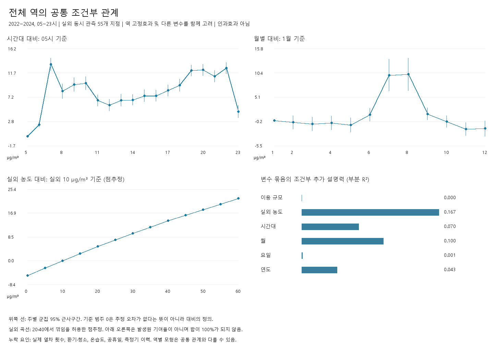
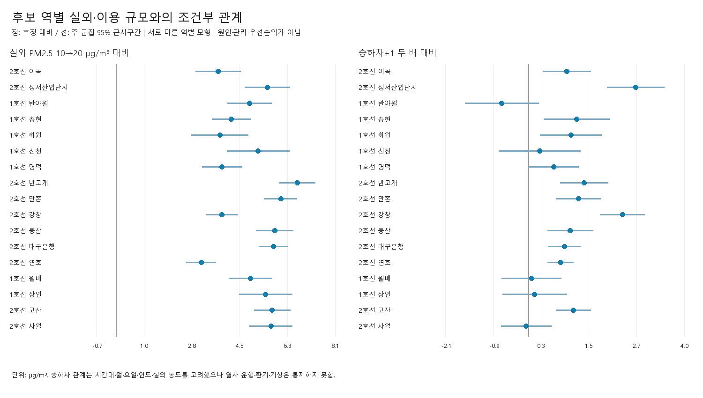

# 전체 역 공통 관계와 후보 역별 점검 가설

## 핵심 결과

2022~2024년 전체 57개 지점의 공통 관계를 분석하고, 기존 후보 17개 역 각각의 진단표를 작성했다. 후보를 다시 선정하거나 원인을 확정하지 않았다. **실외·이용량·시간·월·요일·연도를 함께 고려한 관계**와 **미검증 기전 가설**을 구분했다.

- 전체 공통 확장 모형의 실외 10→20 µg/m³ 대비: **+5.15 µg/m³ (주 군집 95% 근사구간 +4.74~+5.56)**.
- 실외 20→30 µg/m³ 대비: **+4.55 µg/m³ (주 군집 95% 근사구간 +4.19~+4.92)**. 실외 농도 구간에 따라 기울기가 다르게 허용된 결과다.
- 전체 공통 확장 모형의 승하차+1 두 배 대비: **+0.31 µg/m³ (주 군집 95% 근사구간 +0.08~+0.53)**. 승객 이동의 인과효과가 아니며 열차 횟수·환기 등과 분리되지 않는다.
- 후보 역별 이용량 대비의 주 군집 근사구간이 양수인 역 11개, 음수 0개, 0을 포함하는 역 6개. 다중비교를 보정한 발견 개수가 아니므로 유의성 순위로 사용하지 않는다.
- 역마다 시간대·월·실외 반응이 다르다. 개별 진단표에 수치와 경쟁 설명을 제시했다. 조정 후 차이를 환기 불량 또는 내부 발생량으로 바로 해석할 수 없다.

## 표본과 공통 모형

24시간 기술통계는 57개 지점을 모두 포함했다. 승하차가 원자료에 없는 00~04시는 회귀에서 제외하고 0으로 채우지 않았다. 기본 모형 57개 지점 1,155,647개 시간 표본, 실외 포함 확장 모형 55개 지점 1,075,864개 표본이다. 현충로·율하는 실외 비교를 할 수 없어 기본 모형에만 포함했다. 사용 표본·관측률은 sample_coverage.csv에 있다.

실내 수치는 0 이상 유한 숫자 + 상태 공백인 잠정 표본이다. 상태 공백이 공식 정상인지 확인되지 않았다. same_label_v1 시간 구간 가정, 실외 위치 대표성, 누락 변수와 관측 누락의 편향은 남는다. 비교기간 1,096일 중 전체 역의 결합 행이 모두 없는 날짜 5일(2023-07-07, 2023-07-08, 2023-07-09, 2023-07-10, 2023-07-11)은 보간하지 않았다. 관측률 분모는 결측일을 포함한 전체 달력 시간이며 all_station_absent_dates.csv에 기록했다. 이 부재의 원인이 기기인지 수집 시스템인지는 확정하지 않는다.

전체 모형은 역 고정효과, 시간대·월·요일·연도 범주, log2(승하차+1)를 사용한다. 확장 모형은 실외 농도에 20·40 µg/m³ 꺾임을 둔다. 월은 계절을 더 세밀하게 조정하는 변수다. 역별 모형은 같은 구조의 계수가 역마다 달라지도록 별도 적합했다.

실외 추가와 표본 변경을 구분하려고 확장 모형과 정확히 같은 표본에 실외를 빼고 다시 적합했다. 승하차+1 두 배 대비는 전체 기본 표본 +0.61 µg/m³ (주 군집 95% 근사구간 +0.22~+0.99), 같은 실외 동시 표본에서 실외 미포함 +0.64 µg/m³ (주 군집 95% 근사구간 +0.25~+1.02), 실외 포함 +0.31 µg/m³ (주 군집 95% 근사구간 +0.08~+0.53)다. 이 비교는 실외 조정의 영향을 보여주지만 누락 요인 제거를 보장하지 않는다.

| model | contrast | effect | ci_low | ci_high | daily_se | weekly_se | n |
|---|---|---|---|---|---|---|---|
| base_57 | 승하차+1 두 배 | 0.607 | 0.221 | 0.992 | 0.156 | 0.197 | 1155647 |
| outdoor_matched | 승하차+1 두 배 | 0.308 | 0.081 | 0.535 | 0.078 | 0.116 | 1075864 |
| outdoor_matched | 실외 10→20 | 5.150 | 4.740 | 5.560 | 0.166 | 0.209 | 1075864 |
| outdoor_matched | 실외 20→30 | 4.554 | 4.190 | 4.918 | 0.140 | 0.186 | 1075864 |
| outdoor_matched | 실외 40→50 | 3.912 | 3.410 | 4.415 | 0.225 | 0.256 | 1075864 |
| base_same_paired_sample | 승하차+1 두 배 | 0.639 | 0.253 | 1.024 | 0.155 | 0.197 | 1075864 |

## 무엇이 모형 안에서 추가 설명력을 갖는가

| model | factor | partial_r2 |
|---|---|---|
| base_57 | 이용 규모 | 0.001 |
| base_57 | 시간대 | 0.064 |
| base_57 | 월 | 0.056 |
| base_57 | 요일 | 0.003 |
| base_57 | 연도 | 0.030 |
| outdoor_matched | 이용 규모 | 0.000 |
| outdoor_matched | 실외 농도 | 0.167 |
| outdoor_matched | 시간대 | 0.070 |
| outdoor_matched | 월 | 0.100 |
| outdoor_matched | 요일 | 0.001 |
| outdoor_matched | 연도 | 0.043 |
| base_same_paired_sample | 이용 규모 | 0.001 |
| base_same_paired_sample | 시간대 | 0.063 |
| base_same_paired_sample | 월 | 0.057 |
| base_same_paired_sample | 요일 | 0.003 |
| base_same_paired_sample | 연도 | 0.029 |

부분 R²는 다른 묶음을 둔 상태에서 해당 묶음을 뺐을 때 늘어나는 잔차 제곱합을 기준으로 계산했다. 역 고정효과를 제거한 자료 내 공통 관계의 설명력이며 **발생원 기여율이나 원인 중요도 비율이 아니다**. 변수들이 관련되어 있으므로 합이 100%가 되지 않는다. 표본 내 within R²는 기본 0.154, 확장 0.295이며 예측 검증 성능으로 제시하지 않는다.

## 후보 역별 결과

다음 표의 시간대·월 최대/최소는 동일 자료에서 탐색해 고른 것이다. 범위는 개별 대비의 확정 검정 결과가 아니다. 기울기와 조정 수준의 단위는 µg/m³다.

| line | station_name | outdoor_10_20 | usage_doubling | peak_hour | trough_hour | hour_span | peak_month | trough_month | month_span |
|---|---|---|---|---|---|---|---|---|---|
| 2호선 | 이곡 | 3.755 | 0.977 | 7 | 5 | 23.029 | 10 | 5 | 12.638 |
| 2호선 | 성서산업단지 | 5.566 | 2.725 | 7 | 23 | 18.648 | 8 | 3 | 13.046 |
| 1호선 | 반야월 | 4.913 | -0.677 | 22 | 5 | 22.599 | 8 | 12 | 18.374 |
| 1호선 | 송현 | 4.245 | 1.221 | 7 | 6 | 28.690 | 8 | 5 | 17.517 |
| 1호선 | 화원 | 3.816 | 1.077 | 22 | 6 | 29.474 | 1 | 11 | 8.911 |
| 1호선 | 신천 | 5.222 | 0.280 | 22 | 5 | 26.559 | 7 | 9 | 20.087 |
| 1호선 | 명덕 | 3.901 | 0.641 | 22 | 5 | 23.461 | 7 | 12 | 21.165 |
| 2호선 | 반고개 | 6.666 | 1.417 | 19 | 5 | 22.780 | 8 | 6 | 13.848 |
| 2호선 | 만촌 | 6.062 | 1.275 | 19 | 5 | 19.646 | 7 | 1 | 12.631 |
| 2호선 | 강창 | 3.897 | 2.387 | 19 | 6 | 18.730 | 7 | 12 | 13.278 |
| 2호선 | 용산 | 5.834 | 1.055 | 20 | 5 | 15.278 | 8 | 12 | 15.242 |
| 2호선 | 대구은행 | 5.781 | 0.916 | 19 | 5 | 20.312 | 7 | 1 | 18.116 |
| 2호선 | 연호 | 3.129 | 0.814 | 19 | 5 | 26.123 | 7 | 1 | 18.699 |
| 1호선 | 월배 | 4.937 | 0.074 | 7 | 5 | 14.310 | 8 | 5 | 20.282 |
| 1호선 | 상인 | 5.504 | 0.158 | 10 | 5 | 16.174 | 8 | 4 | 12.979 |
| 2호선 | 고산 | 5.745 | 1.144 | 21 | 5 | 18.735 | 8 | 2 | 11.150 |
| 2호선 | 사월 | 5.696 | -0.058 | 7 | 5 | 19.066 | 7 | 5 | 15.592 |

- [2호선 이곡](station_reports/DG_L2_2220.md)
- [2호선 성서산업단지](station_reports/DG_L2_2210.md)
- [1호선 반야월](station_reports/DG_L1_1440.md)
- [1호선 송현](station_reports/DG_L1_1220.md)
- [1호선 화원](station_reports/DG_L1_1160.md)
- [1호선 신천](station_reports/DG_L1_1340.md)
- [1호선 명덕](station_reports/DG_L1_1290.md)
- [2호선 반고개](station_reports/DG_L2_2280.md)
- [2호선 만촌](station_reports/DG_L2_2350.md)
- [2호선 강창](station_reports/DG_L2_2190.md)
- [2호선 용산](station_reports/DG_L2_2230.md)
- [2호선 대구은행](station_reports/DG_L2_2320.md)
- [2호선 연호](station_reports/DG_L2_2370.md)
- [1호선 월배](station_reports/DG_L1_1190.md)
- [1호선 상인](station_reports/DG_L1_1200.md)
- [2호선 고산](station_reports/DG_L2_2390.md)
- [2호선 사월](station_reports/DG_L2_2410.md)

## 역별 점검의 출발점

| 역 | 먼저 대조할 변수 묶음 | 연결할 점검 가설 |
|---|---|---|
| 2호선 이곡 | 시간대, 연도 | 운행·환기·청소 시간 주기 대조 / 설비·기기·청소 및 이용 회복 이력 대조 |
| 2호선 성서산업단지 | 실외 농도, 시간대 | 외부 유입·공통 기상과 실외 대리변수 확인 / 운행·환기·청소 시간 주기 대조 |
| 1호선 반야월 | 월, 시간대 | 계절별 환기·온습도와 외부 반응 대조 / 운행·환기·청소 시간 주기 대조 |
| 1호선 송현 | 시간대, 실외 농도 | 운행·환기·청소 시간 주기 대조 / 외부 유입·공통 기상과 실외 대리변수 확인 |
| 1호선 화원 | 시간대, 연도 | 운행·환기·청소 시간 주기 대조 / 설비·기기·청소 및 이용 회복 이력 대조 |
| 1호선 신천 | 월, 시간대 | 계절별 환기·온습도와 외부 반응 대조 / 운행·환기·청소 시간 주기 대조 |
| 1호선 명덕 | 월, 시간대 | 계절별 환기·온습도와 외부 반응 대조 / 운행·환기·청소 시간 주기 대조 |
| 2호선 반고개 | 실외 농도, 시간대 | 외부 유입·공통 기상과 실외 대리변수 확인 / 운행·환기·청소 시간 주기 대조 |
| 2호선 만촌 | 실외 농도, 시간대 | 외부 유입·공통 기상과 실외 대리변수 확인 / 운행·환기·청소 시간 주기 대조 |
| 2호선 강창 | 시간대, 실외 농도 | 운행·환기·청소 시간 주기 대조 / 외부 유입·공통 기상과 실외 대리변수 확인 |
| 2호선 용산 | 실외 농도, 월 | 외부 유입·공통 기상과 실외 대리변수 확인 / 계절별 환기·온습도와 외부 반응 대조 |
| 2호선 대구은행 | 실외 농도, 월 | 외부 유입·공통 기상과 실외 대리변수 확인 / 계절별 환기·온습도와 외부 반응 대조 |
| 2호선 연호 | 시간대, 월 | 운행·환기·청소 시간 주기 대조 / 계절별 환기·온습도와 외부 반응 대조 |
| 1호선 월배 | 월, 실외 농도 | 계절별 환기·온습도와 외부 반응 대조 / 외부 유입·공통 기상과 실외 대리변수 확인 |
| 1호선 상인 | 실외 농도, 월 | 외부 유입·공통 기상과 실외 대리변수 확인 / 계절별 환기·온습도와 외부 반응 대조 |
| 2호선 고산 | 실외 농도, 시간대 | 외부 유입·공통 기상과 실외 대리변수 확인 / 운행·환기·청소 시간 주기 대조 |
| 2호선 사월 | 실외 농도, 월 | 외부 유입·공통 기상과 실외 대리변수 확인 / 계절별 환기·온습도와 외부 반응 대조 |

조건부 추가 설명력이 큰 두 변수 묶음을 점검 출발점으로 정리했다. 이것은 **원인 확률의 순위가 아니며**, 다른 가설을 배제하지 않는다. 각 역의 구체적 시간대·월·대비는 진단표에 있다.

## 점검 가설과 확인 순서

17개 역에 각 7개씩, 총 119개 가설 기록을 만들었다. 가설 유형은 외부 유입/공통 기상, 내부 마모·재비산/잔류, 운행·환기 시간 주기, 이용·열차 동반 변화, 계절 운영/습도, 장기 설비·측정 변화, 실외 측정소 대표성이다. 유형은 공통이지만 **역별 실제 수치·최대 시간대·계절·구간·거리**를 근거로 다르게 정리했다. 이 중 어떤 시설이 실제로 불량하다고 확인한 것은 없다.

1. 측정기·단위·시각·점검 이력부터 대조한다. 농도 차이가 측정 차이인지 확인한다.
2. 진단표에서 높은 시간대와 낮은 시간대를 골라 열차·환기·청소 기록을 대조한다.
3. 실외가 낮아도 높은 역은 내부 발생·잔류와 실외 대리변수 오차를 함께 확인한다.
4. 이용량 대비가 음수여도 승객이 먼지를 줄인다고 해석하지 않는다. 시간대별 운행·환기·주말 구성과 모형 제한을 먼저 점검한다.
5. 자료로 판별되지 않는 가설은 필요한 기록·현장 측정·비교 설계를 붙여 후속 점검 대상으로 남긴다.

기전의 일반적 근거는 [Health Canada 지침](https://www.canada.ca/en/health-canada/services/publications/healthy-living/guidance-improving-subway-air-quality.html)이다. 지침은 환기·여과, 마모·제동, 청소, 스크린도어 등 여러 경로를 제시하며 시설별 검증 필요성을 강조한다. 우리 역별 기전을 입증하는 근거로 인용한 것은 아니다.

## 불확실성과 민감도

- 주별 군집 강건 근사구간은 같은 주의 시공간 상관을 허용한다. 주 사이 상관·관측 누락·측정 오차를 완전히 해결하지 않는다. 하루 군집 표준오차도 표에 병기했다.
- 주 모형과 같은 표본에서 역별 실내 상위 0.5%를 제한해 재적합했다. 방향이 바뀐 역·대비·모형 조합 0개는 winsor_direction_changes.csv에 모두 저장했다. 작은 계수의 부호만으로 결론을 내리지 않는다.
- 후보는 같은 2022~2024년 자료로 선정되고 분석되었다. 선택 후 분석이며 독립 검증이나 인과 식별이 아니다. 향후 새로운 기간에서 재현 확인이 필요하다.
- 실외 농도별 반응의 계절·시간 상호작용, 지연 효과, 비선형 이용량, 역 주변 공사, 공휴일, 실제 열차 횟수·온습도·시설 이력은 이번 모형에 포함되지 않았다. 부분 조정 구간 그림이 선형 계수와 다르면 모형 단순화의 징후로 확인할 수 있다.
- 조정 역 평균은 확장 표본 전체의 동일한 설명변수 평균을 각 역에 적용했다. 다른 역의 이용 규모가 해당 역의 관측 범위를 벗어날 수 있고 역별 기울기가 공통이라는 가정도 있으므로 관리 순위로 쓰지 않는다.

## 산출물

- plan.md: 분석 설계.
- station_reports/: 후보 17개 역별 보고서.
- tables/hypotheses.csv: 근거·검증 상태·경쟁 설명·필요 자료·검증 방법을 가진 전체 가설.
- tables/candidate_factor_summary.csv, effect_contrasts.csv: 역별 대비와 불확실성.
- tables/coefficients.csv, conditional_partial_r2.csv, model_fit.csv: 전체·역별 모형.
- tables/adjusted_profiles.csv, partial_adjustment_bins.csv, raw_*.csv: 그림·관계의 근거.
- tables/adjusted_station_levels.csv: 동일 조건에서의 공통 모형 역 수준(별도 인과 의미 없음).
- figures/: 요약 및 역별 PNG·SVG. 한글 SVG는 Malgun Gothic 글꼴 사용.
- validation.json: 수치 검증. 재현 스크립트 data/_scripts/analyze_station_factors.py, numpy·pandas·Pillow 필요.

재현 순서: `python data/_scripts/analyze_station_factors.py`, `python data/_scripts/render_factor_overview.py`, `python data/_scripts/finalize_factor_analysis.py`. 첫 스크립트가 모형·기본 보고서를 만들고 두 번째가 공통 요약 그림, 세 번째가 역별 점검 출발점과 독립 수치 검증을 추가한다. 새 실행의 이미지 검증 상태는 시각 확인 전까지 pending이다.

원본 수정·추가 데이터 수집·Git 커밋·푸시는 수행하지 않았다. task.md는 로컬 진행표로만 갱신한다.
