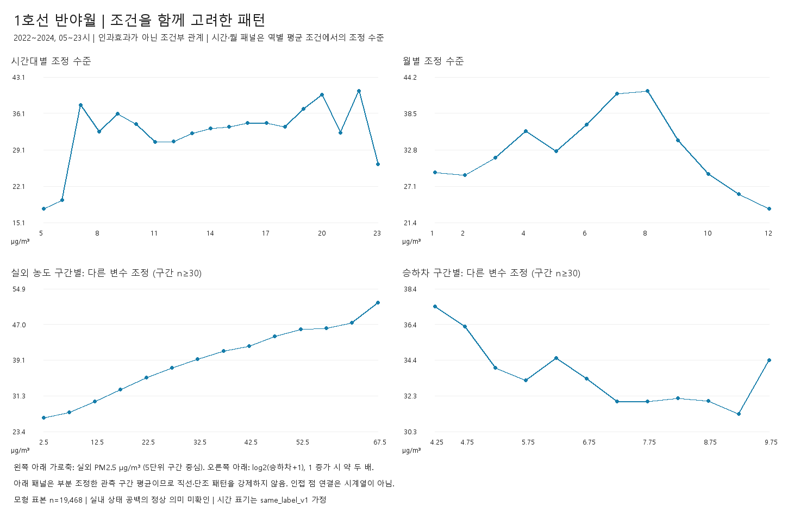

# 1호선 반야월: 관계 분석과 점검 가설

## 선정 배경과 표본

기존 후보 선정 이유: 평상시 수준, 고농도 빈도, 월별 반복성, 실외 대비 차이, 동시각 상대 수준. 이번 분석에서 후보를 다시 선정하지 않았다. 비교기간 2022~2024년, 회귀는 05~23시 동시 관측 19,468개. 실내·승하차 관측률 95.87%, 실외 포함 관측률 93.49%. 상태 공백의 공식 정상 의미는 미확인이다.

## 자료에서 확인되는 관계

- 실외 10→20 대비 +4.91 µg/m³ (주 군집 95% 근사구간 +4.11~+5.72); 양의 관계가 관찰됨(인과 미확인). 20→30 대비 +3.85 µg/m³ (주 군집 95% 근사구간 +2.98~+4.72). 관측 실외 5~95백분위 3.0~42.0.
- 승하차+1 두 배 대비 -0.68 µg/m³ (주 군집 95% 근사구간 -1.61~+0.26); 구간이 0을 포함해 방향이 불확실함. 승하차 5~95백분위 47~588건/시간.
- 다른 변수를 고정한 시간대 패턴은 22시 최대, 05시 최소, 차이 22.60 µg/m³. 최대·최소는 같은 자료에서 탐색한 값으로 차이의 확정 검정은 아님.
- 월 조정 패턴은 8월 최대, 12월 최소, 범위 18.37 µg/m³. 월 최대·최소도 탐색적 선택.
- 2024년-2022년 조정 대비 -2.56 µg/m³ (주 군집 95% 근사구간 -4.51~-0.61). 연도 차이는 특정 교체 사건을 확인한 것이 아님.
- 24시간 기술통계에서 실외≤10인 표본 8,791개에서 실내 중앙값 25.10; 실내-실외 차이 중앙값 19.00 µg/m³. 이 값은 조건 미조정 기술통계.
- 00~04시 유효 관측 5,287개, 평균 25.48 µg/m³. 이 시간대는 회귀에 포함하지 않았으며 영업·비영업 상태를 확인한 구분도 아니다.
- 연결 실외 측정소 서호동, 거리 0.43 km. 역 입구·흡기구 농도는 관측하지 않음.

## 대비와 불확실성

| contrast | effect | ci_low | ci_high | winsor_effect | daily_se | weekly_se |
|---|---|---|---|---|---|---|
| 승하차+1 두 배 | -0.677 | -1.613 | 0.258 | -0.807 | 0.404 | 0.477 |
| 실외 10→20 | 4.913 | 4.105 | 5.721 | 4.822 | 0.373 | 0.412 |
| 실외 20→30 | 3.851 | 2.978 | 4.723 | 4.029 | 0.353 | 0.445 |
| 실외 40→50 | 3.982 | 3.008 | 4.957 | 4.019 | 0.443 | 0.497 |

effect·ci_low·ci_high는 µg/m³. 주별 군집 95% 근사구간이며 다중비교 보정·인과 식별 결과가 아니다. winsor_effect는 해당 역 실내 상위 0.5%를 제한했을 때 같은 표본으로 재적합한 값이다. daily_se는 하루 군집, weekly_se는 주 군집의 표준오차다. 표본 밖의 농도 대비나 사용량 두 배 변화로 외삽하지 않는다.

## 현재 모형의 조건부 추가 설명력

| factor | partial_r2 |
|---|---|
| 월 | 0.130 |
| 시간대 | 0.113 |
| 실외 농도 | 0.112 |
| 연도 | 0.048 |
| 요일 | 0.009 |
| 이용 규모 | 0.000 |

부분 R²는 다른 변수가 있을 때 해당 묶음을 추가한 표본 내 설명력이다. 상관된 변수 사이에서 순위가 달라질 수 있고, 합이 100%가 되지 않으며 발생원 기여율이 아니다. 이용량의 설명력이 작아도 많은 사람이 이용하는 관리상 중요성은 사라지지 않는다.

## 먼저 대조할 관측 단서

- **월**: 조건부 부분 R² 0.130. 8월 최대 / 12월 최소, 범위 18.37 µg/m³. → H05: 계절별 환기·온습도와 외부 반응 대조.
- **시간대**: 조건부 부분 R² 0.113. 조정 패턴 22시 최대 / 05시 최소, 범위 22.60 µg/m³. → H03: 운행·환기·청소 시간 주기 대조.

위 순서는 현재 모형에서 추가 설명력이 큰 두 묶음을 골라 점검의 출발점을 정한 것이며, 원인 확률·발생원 기여도·관리 순위가 아니다. 나머지 가설도 배제하지 않는다. 같은 원인이 여러 변수에 걸쳐 나타날 수 있다.

## 점검할 가설

### H01. 외부 오염 유입 또는 공통 기상 영향

- 구분: **통계 관계는 평가 가능; 유입 경로는 미검증**
- 이 역의 관측 근거: 실외 10→20 대비 +4.91 µg/m³ (주 군집 95% 근사구간 +4.11~+5.72); 양의 관계가 관찰됨(인과 미확인). 20→30 대비 +3.85 µg/m³ (주 군집 95% 근사구간 +2.98~+4.72). 관측 실외 5~95백분위 3.0~42.0.
- 경쟁 설명: 실외와 실내가 함께 변해도 기상·운영 같은 공통 요인 때문일 수 있음
- 추가로 필요한 자료: 흡기구·출입구·실외 동시 측정, 풍향·풍속·환기 가동 기록
- 검증 방법: 실외 고농도 사건 전후와 시간 지연을 비교하고 환기 상태별 반응을 확인

### H02. 내부 마모·쌓인 먼지의 재비산 또는 공기 교환 부족

- 구분: **기전 미검증 가설**
- 이 역의 관측 근거: 24시간 기술통계에서 실외≤10인 표본 8,791개에서 실내 중앙값 25.10; 실내-실외 차이 중앙값 19.00 µg/m³. 이 값은 조건 미조정 기술통계.
- 경쟁 설명: 실외 관측소 대표성·기기 편향·기존 먼지 잔류도 같은 패턴을 만듦
- 추가로 필요한 자료: 터널·승강장 입자 성분(철 등), 청소 기록, 환기 풍량, 열차·제동 기록
- 검증 방법: 청소·환기 전후 및 비슷한 조건의 비교 역과 비교; 성분자료로 발생원 확인

### H03. 시간대별 운행·환기·청소 주기 차이

- 구분: **시간대 관계는 평가 가능; 세부 기전 미검증**
- 이 역의 관측 근거: 다른 변수를 고정한 시간대 패턴은 22시 최대, 05시 최소, 차이 22.60 µg/m³. 최대·최소는 같은 자료에서 탐색한 값으로 차이의 확정 검정은 아님.
- 경쟁 설명: 승객·열차·환기가 시간대별로 함께 바뀌며 실제 측정 구간도 불확실
- 추가로 필요한 자료: 시간별 열차 도착·환기 스케줄·청소·유지보수 기록
- 검증 방법: 관측 최고·최저 시간대에 현장 동시 측정하고 운행·환기 변경 전후 비교

### H04. 승객 이동 재비산 또는 열차 운행과 이용량의 동반 변화

- 구분: **조건부 관계는 평가 가능; 승객의 인과효과 미검증**
- 이 역의 관측 근거: 승하차+1 두 배 대비 -0.68 µg/m³ (주 군집 95% 근사구간 -1.61~+0.26); 구간이 0을 포함해 방향이 불확실함. 승하차 5~95백분위 47~588건/시간.
- 경쟁 설명: 승하차는 플랫폼 체류 인원이 아니며 열차 횟수·공휴일을 통제하지 못함
- 추가로 필요한 자료: 승강장 체류·혼잡도·열차 횟수·공휴일·환승 흐름
- 검증 방법: 같은 시간대·실외 조건에서 이용이 다른 날 비교하고 열차 횟수를 추가 조정

### H05. 계절별 환기 운영·습도·실내 입자 거동 변화

- 구분: **월별 관계는 평가 가능; 계절 기전 미검증**
- 이 역의 관측 근거: 월 조정 패턴은 8월 최대, 12월 최소, 범위 18.37 µg/m³. 월 최대·최소도 탐색적 선택.
- 경쟁 설명: 실외 반응의 계절 차이·습도에 따른 측정 특성·운행 변화가 경쟁 설명
- 추가로 필요한 자료: 실내외 온습도·냉난방·환기·필터 교체 기록
- 검증 방법: 계절별 실외 반응과 습도 보정 후 월별 패턴이 유지되는지 확인

### H06. 시설 운영·청소·측정기 보정 또는 교체의 장기 변화

- 구분: **연도별 관계는 평가 가능; 사건·기전 미검증**
- 이 역의 관측 근거: 2024년-2022년 조정 대비 -2.56 µg/m³ (주 군집 95% 근사구간 -4.51~-0.61). 연도 차이는 특정 교체 사건을 확인한 것이 아님.
- 경쟁 설명: 설비 개선 외에 이용 회복·외부 환경·센서 변화·누락 시기 차이도 가능
- 추가로 필요한 자료: 측정기 점검·보정·이전·교체, 시설 공사·필터·청소 이력
- 검증 방법: 변경 날짜가 확보되면 전후 단절·비교 역 차이를 분석; 교정기와 병행 측정

### H07. 선택 실외 측정소의 공간 대표성 부족

- 구분: **현재 자료로 검증 불가한 측정·공간 가설**
- 이 역의 관측 근거: 연결 실외 측정소 서호동, 거리 0.43 km. 역 입구·흡기구 농도는 관측하지 않음.
- 경쟁 설명: 실제 내부 발생 차이와 실외 대리변수 오차를 현재 자료만으로 분리 불가
- 추가로 필요한 자료: 역 흡기구 측정, 다른 근접 실외 측정소와 풍향 자료
- 검증 방법: 실외 측정소를 바꾼 민감도와 흡기구 실측을 비교

가능한 기전의 일반적 근거: [Health Canada 지하철 공기질 지침](https://www.canada.ca/en/health-canada/services/publications/healthy-living/guidance-improving-subway-air-quality.html). 이 지침이 이 역의 원인을 입증하는 것은 아니다.

## 현장 점검에서의 해석

자료상 시간대·월 패턴과 실외 반응을 우선 확인하고, 기기 검증과 운영 기록 대조를 함께 진행하는 것이 적절하다. 환기 불량·제동 마모·청소 부족 등은 후보 가설이며 이 역에서 실제 발생했다고 확인한 사실이 아니다. 실외 차이·조정 잔여 차이를 내부 발생량으로 바꾸어 해석하지 않는다.
